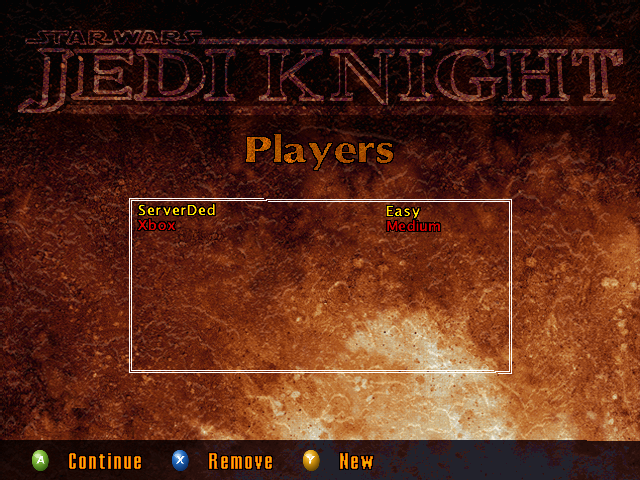
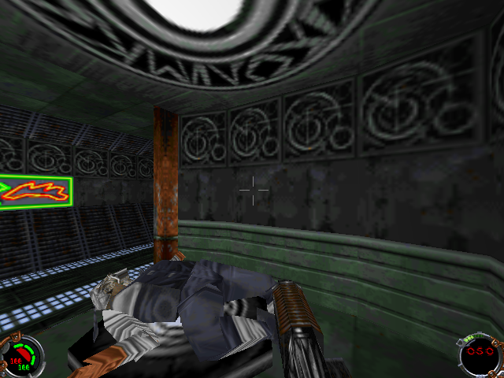
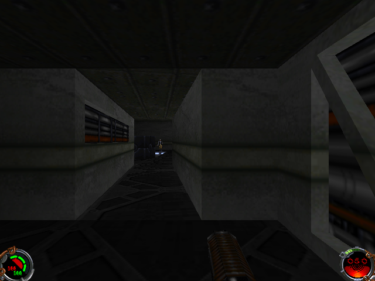
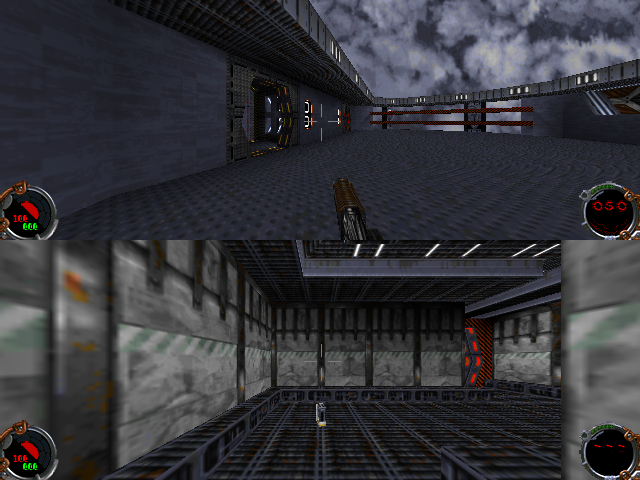

# OpenJKDF2-ogx — Original Xbox Port

This repository is a fork of [OpenJKDF2](https://github.com/shinyquagsire23/OpenJKDF2)
focused on porting the engine to the original Microsoft Xbox console. The base
engine lineage is preserved underneath; Xbox-specific runtime work lives under
`src/Platform/Xbox/`.

**Current release: [OpenJKDF2x Xbox v1.0](https://github.com/GTTeancum/OpenJKDF2ogx/releases/tag/v1.0).**
Download [OpenJKDF2x-Xbox-v1.0.zip](https://github.com/GTTeancum/OpenJKDF2ogx/releases/download/v1.0/OpenJKDF2x-Xbox-v1.0.zip)
and read the [update notes](docs/RELEASE_NOTES_v1.0.md).
Report bugs on
[GitHub Issues](https://github.com/GTTeancum/OpenJKDF2ogx/issues).

  

## Install and Play

1. Extract the release ZIP and copy `OpenJKDF2x-Xbox-v1.0` to your Xbox HDD.
2. Add your legally owned Jedi Knight resource archives to `Resource/` and
   episode archives to `Episode/`.
3. Launch `default.xbe`. The main menu shows **v1.0** at the bottom right.

For native Mysteries of the Sith, also place `JKMRES.GOO` and `JKMsndLO.goo`
in `Resource/`, and the original MotS episode `.GOO` files in `Episode/`.
Select MotS through the menus. Both its resource and episode files are required;
the old `mots_xbox_patch.gob` compatibility overlay is unnecessary for native MotS.

The package includes controller UI assets, the Xbox Force Jump patch, the
multiplayer HUD, and the cutscene converter. Convert your own videos to Xbox
XMV using `OpenJKDF2xCutsceneConverter.exe`; instructions and licenses are in
`CUTSCENE_CONVERSION_README.txt`. Supply your own game archives and videos.

## v1.0 Highlights

- Revised setup and controls menus, display calibration, and safe-zone markers.
- Local multiplayer bots, improved navigation, and a dedicated multiplayer HUD.
- Optional modern saber rendering with boss attack trails; stock saber mode
  keeps the original behavior.
- Expanded native MotS support and automatic console-enabled 720p selection
  with lower-resolution fallback.

The release build's v1.0 main menu was visually verified in XEMU. External
OBS/TV confirmation of the recent 720p output revision remains outstanding,
and System Link needs broader console testing. See the
[release notes](docs/RELEASE_NOTES_v1.0.md) for validation limits and known issues.

## Screenshots

| Menu | Jedi Knight |
| --- | --- |
|  |  |
| Mysteries of the Sith | Multiplayer |
|  |  |

## Credits and Legal Notes

OpenJKDF2x is an original Xbox port of OpenJKDF2. The upstream engine is
Copyright (C) OpenJKDF2 contributors, and the Xbox port keeps that lineage.
Jedi Knight: Dark Forces II, Mysteries of the Sith, STAR WARS, LucasArts, and
related properties remain the property of Lucasfilm Ltd. and its affiliates.
No retail game assets are included with OpenJKDF2x; users must provide their
own legally owned game data.

The Xbox renderer uses FakeGL/xquake code Copyright (C) 2000 Jack Palevich,
under the terms stated in `src/Platform/Xbox/fakeglx.cpp`. Xbox release packages
may also include OpenJKDF2xCutsceneConverter.exe; when that tool is shipped,
its bundled FFmpeg/Gyan.dev notices and license text are included in
`CUTSCENE_CONVERSION_README.txt`.
The multiplayer HUD is JK HUD Revamp by Quib Mask; its original credits and
distribution permission are preserved in the included `jkhud.txt`.

## Renderer

The Xbox renderer is based on **xquake's FakeGL** (`src/Platform/Xbox/fakeglx.cpp` +
`gl/gl.h`), adapted from Microsoft's xquake port to original Xbox.
`std3D.c` is a thin C adapter that exposes OpenJKDF2's existing `std3D_*` API
and translates each call into FakeGL's `gl*` / `wgl*` / `FakeSwapBuffers`
entry points.  We do not call D3D8 directly anywhere in the Xbox renderer
path.

The choice was deliberate: every attempt to write our own D3D8 backend ran
into NV2A draw-submission wedges where any real `DrawPrimitiveUP` call would
return CPU-side but `Present` would block forever.  Microsoft's renderer is
proven on retail hardware, so it became the renderer.

## Building (Xbox)

- **SDK:** XDK 5558 at `C:\XDK_5558\XDK\xbox\`.
- **Toolchain:** XDK VC71 `cl.exe` (Visual Studio 2005's compiler can't handle
  XDK D3D8 headers in C89 mode).
- **Build:** `build_xbox.bat` from the repo root.  Output: `build/xbox/release/default.xbe`.
- **Deploy:** FTP the XBE (and game assets) onto the Xbox HDD.

See [the release manifest](docs/BETA_RELEASE_MANIFEST.md) for packaging details
and [MotS compatibility notes](docs/MOTS_XBOX_COMPAT.md) for expansion support.

---

## Upstream

OpenJKDF2x is based on [OpenJKDF2](https://github.com/shinyquagsire23/OpenJKDF2). See the upstream project for the original desktop-focused README, source history, and non-Xbox platform details.
